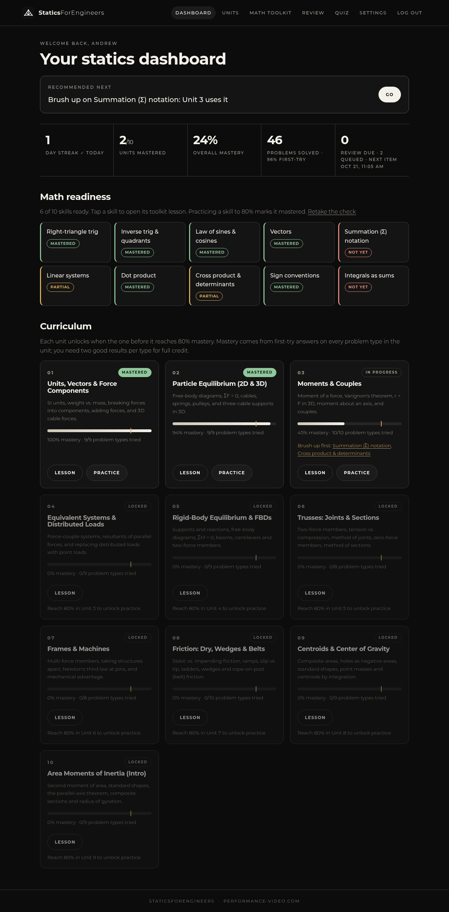

# StaticsForEngineers

A self-hosted, mastery-based course in **engineering statics**: the first "real" mechanical-engineering
class. It has ten units, from vectors to area moments of inertia. Each unit has a lesson with worked
examples and diagrams, then unlimited randomized practice problems with hints and full worked
solutions. Progress, a spaced-review queue, streaks and a mixed-review quiz are saved per user.

Because statics leans on math that many strong algebra students haven't met yet (Σ notation, vectors,
cross products, "integrals as sums"), it starts with a **math readiness check**. Skills you already
have are marked done; gaps get a short **Math toolkit** lesson that is suggested just before the unit
that needs it.

It is designed to live at **https://performance-video.com/StaticsForEngineers/**, next to the existing
site on the same DigitalOcean droplet. Nothing about the existing site changes except one `include` line
that you add yourself.



---

## Contents

1. [What's inside](#whats-inside)
   * [Math readiness check & Math toolkit](#math-readiness-check--math-toolkit)
2. [Put it on the droplet (step by step)](#put-it-on-the-droplet-step-by-step)
   * [Updating the live site (update script)](#updating-the-live-site-update-script)
   * [Reverse proxy in Docker (Caddy)](#reverse-proxy-in-docker-caddy)
3. [Connect Nginx (the one manual edit)](#connect-nginx-the-one-manual-edit)
4. [HTTPS](#https)
5. [Day-to-day: logins, updates, backups](#day-to-day-logins-updates-backups)
6. [Troubleshooting](#troubleshooting)
7. [Manual install (if you'd rather not use setup.sh)](#manual-install-if-youd-rather-not-use-setupsh)
8. [Settings reference (.env)](#settings-reference-env)
9. [Running it on your own computer](#running-it-on-your-own-computer)

---

## What's inside

| # | Unit | Problem types |
|---|------|---|
| 1 | Units, vectors & force components | 9 |
| 2 | Particle equilibrium (2D & 3D) | 9 |
| 3 | Moments & couples | 10 |
| 4 | Equivalent systems & distributed loads | 9 |
| 5 | Rigid-body equilibrium & FBDs | 9 |
| 6 | Trusses: joints & sections | 8 |
| 7 | Frames & machines | 8 |
| 8 | Friction: dry, wedges & belts | 10 |
| 9 | Centroids & center of gravity | 9 |
| 10 | Area moments of inertia | 9 |

That's **90 problem types**. Each type produces new numbers every time you click it, so practice never
runs out. Features:

* **Lessons** with typeset math (KaTeX, stored locally so no CDN is needed), worked examples and diagrams.
* **Answer checking** within about 2%, with units shown next to every answer box. Hints appear one at a
  time. The worked solution unlocks after your first try.
* **Mastery.** Each unit's score comes from first-try answers on each problem type; hints reduce the
  credit a little. The next unit unlocks at **80%**, and a "Recommended next" card always says what
  to do.
* **Spaced review.** A missed problem type comes back after 10 minutes, then after 1, 3, 7 and 14 days,
  until you get it right enough times.
* **Dashboard** with your streak, units mastered, overall mastery and review count. There's also a
  **10-question mixed quiz** drawn from the units you've completed.
* **Login required** for every page. Passwords are bcrypt-hashed, logins are rate-limited, and forms
  are CSRF-protected. Each user can change their password in Settings, and there's a command-line tool
  to add users or reset passwords.
* Styled to match performance-video.com: a dark background, warm off-white text and Montserrat. It
  works on phones.
* **Reading the math.** Each unit lesson explains new notation the first time it appears, in a
  "Reading the math" box: the symbol, how to say it out loud, and what it means, with a link to the
  matching toolkit lesson. Key symbols (Σ, subscripts, ×, ·, ∫, dA, x̄, μ, …) are underlined; hover or
  tap one for a short explanation.

### Math readiness check & Math toolkit

The **readiness check** opens automatically the first time a user reaches the dashboard. It can be
skipped ("Maybe later") and retaken any time from the dashboard or Settings. It assumes Algebra II and
covers 10 skills:

| # | Skill | Used in units | Toolkit problem types |
|---|---|---|---|
| M1 | Right-triangle trig (SOH-CAH-TOA) | 1, 2, 6, 8 | 4 |
| M2 | Inverse trig & quadrants (atan2) | 1 | 4 |
| M3 | Law of sines & law of cosines | 1 | 4 |
| M4 | Vectors: components, magnitude, unit vectors | 1, 2 | 5 |
| M5 | Summation (Σ) & index notation | 2, 3, 4, 5, 6, 7, 9, 10 | 4 |
| M6 | Solving 2×2 and 3×3 linear systems | 2, 5, 6, 7, 8 | 5 |
| M7 | Dot product | 1, 3 | 4 |
| M8 | Cross product & determinants | 3 | 5 |
| M9 | Sign conventions & coordinate systems | 3, 4, 5, 6, 7, 8 | 4 |
| M10 | Integrals as sums (no calculus needed) | 4, 9, 10 | 5 |

* **How the check works:** mostly randomized numeric questions plus a few concept questions, with no
  hints. Each skill gets 2 questions; if they disagree, a 3rd decides. That's 20–30 questions, about
  15 minutes. "I haven't learned this yet" skips a question honestly. Results per skill: **Mastered**
  (2/2), **Partial** (2/3) or **Not yet**. Check answers don't touch statics mastery or the review queue.
* **Math toolkit:** one short lesson per skill (written for a strong algebra student, with every
  symbol explained and read aloud, plus worked examples), followed by unlimited randomized practice
  with hints and solutions. That's 44 more problem types, 134 in total. Practicing a skill to 80%
  marks it Mastered even if the check said otherwise.
* **Soft gating:** every unit and every problem type is tagged with the skills it uses. If a unit
  needs a skill that isn't solid yet, "Recommended next" on the dashboard points to that toolkit
  lesson first (then its practice). The unit page shows a "Before you start, brush up on …" card, and
  practice problems that use the skill carry a one-line reminder with a link. Nothing is locked; you
  can always keep going.

### File layout

```
statics-for-engineers/
├── server.js                 Express app (routes, login, API)
├── src/                      config, database (+ migrations), sessions, users, progress/mastery logic,
│                             readiness check (readiness.js), page templates
├── content/
│   ├── units/u01.js … u10.js lessons + problem generators for each unit
│   ├── skills.js             the 10 math skills, unit/problem → skill map, symbol glossary
│   ├── toolkit/              one lesson + problem generators per math skill
│   ├── helpers.js, svg.js    math helpers and diagram drawing
│   └── index.js              unit registry, grading, rendering
├── public/                   CSS, browser JS, favicon, font CSS
├── scripts/user.js           add / reset / delete / list users
├── scripts/verify-problems.js  checks every problem generator against independent solvers
├── test/smoke.mjs            end-to-end HTTP test
├── deploy/
│   ├── setup.sh              installer for Ubuntu (run with sudo)
│   ├── staticsforengineers.service   systemd unit
│   └── nginx.conf            location snippet for the existing performance-video.com site
├── screenshots/              what it looks like
├── .env.example              settings template (copy to .env)
└── data/                     created at runtime: the SQLite database (not in the tarball)
```

---

## Put it on the droplet (step by step)

You need the file `staticsforengineers.tar.gz`, the droplet's IP address (or `performance-video.com`),
and a login on the droplet that can use `sudo`. These steps work on Ubuntu 22.04 or 24.04.

### 1. Copy the file to the droplet

On **your own computer**, open a terminal (Mac: Terminal app; Windows: PowerShell) in the folder that
has the tarball, and run this (change `root` if you log in as a different user):

```bash
scp staticsforengineers.tar.gz root@performance-video.com:~
```

### 2. Log in to the droplet and unpack

```bash
ssh root@performance-video.com
tar xzf staticsforengineers.tar.gz
cd statics-for-engineers
```

### 3. Run the installer

```bash
sudo bash deploy/setup.sh
```

It asks for the **username and password** of the first account (for example `Andrew`). Typing the
password shows nothing on screen; that's normal. Then it:

* installs **Node.js 24 LTS** if Node 22+ isn't already there;
* creates a locked-down system user `staticsforengineers`;
* copies the app to `/opt/staticsforengineers`;
* writes `/opt/staticsforengineers/.env` with a random `SESSION_SECRET`, your login and `COOKIE_SECURE=true`;
* installs the libraries and starts the app as the systemd service **`staticsforengineers`**,
  listening on `127.0.0.1:3117` (the droplet itself only, not the internet);
* copies the Nginx snippet to `/etc/nginx/snippets/staticsforengineers.conf`.

It does **not** touch your existing Nginx site, reload Nginx or run certbot. When it finishes, it
prints the last manual step, described next.

Check that the app is running:

```bash
sudo systemctl status staticsforengineers     # should say "active (running)"; press q to exit
curl http://127.0.0.1:3117/StaticsForEngineers/healthz    # should print: ok
```

---

## Connect Nginx (the one manual edit)

The existing performance-video.com site already has an Nginx config with HTTPS set up. You add **one
line** to it so that addresses starting with `/StaticsForEngineers/` are passed to the app. Everything
else on the site keeps working exactly as before.

**1. Find the config file for the site:**

```bash
grep -rl "performance-video.com" /etc/nginx/sites-enabled/ /etc/nginx/conf.d/
```

It's usually `/etc/nginx/sites-enabled/performance-video.com` or `/etc/nginx/sites-enabled/default`.
Many of these are links into `sites-available`, and you can edit either one. Below, the file is
called `SITEFILE`.

**2. Back it up first:**

```bash
sudo cp SITEFILE ~/nginx-site-backup-$(date +%F).conf
```

**3. Edit it:**

```bash
sudo nano SITEFILE
```

Find the `server {` block that contains `listen 443 ssl` (certbot adds lines marked
`# managed by Certbot`; that's the right block). Inside it, next to the other `location` lines, add:

```nginx
    include snippets/staticsforengineers.conf;
```

For example:

```nginx
server {
    server_name performance-video.com www.performance-video.com;
    root /var/www/performance-video.com;
    location / { try_files $uri $uri/ =404; }

    include snippets/staticsforengineers.conf;     # <-- the new line

    listen 443 ssl; # managed by Certbot
    ...
}
```

Don't add it to the small port-80 block that only redirects to HTTPS. Save with **Ctrl+O, Enter**, then
exit with **Ctrl+X**.

**4. Test, then reload:**

```bash
sudo nginx -t
```

Only if that prints `syntax is ok` and `test is successful`, run:

```bash
sudo systemctl reload nginx
```

`reload` swaps in the new config without dropping visitors. If `nginx -t` shows an error, nothing has
changed yet. Fix the typo, or restore the backup with `sudo cp ~/nginx-site-backup-*.conf SITEFILE`.

**5. Visit https://performance-video.com/StaticsForEngineers/** and log in.

The snippet (`deploy/nginx.conf`) contains only two `location` blocks:
`/StaticsForEngineers` redirects to `/StaticsForEngineers/`, and `/StaticsForEngineers/…` is proxied to
`http://127.0.0.1:3117` with the path left unchanged. It is not a separate site (no `server` block).

---

## HTTPS

There's nothing extra to do. The app sits inside the existing HTTPS site, so it uses the certificate
certbot already manages for performance-video.com, and certbot's automatic renewals keep working.

* **Do not** run `certbot --nginx` again just for this app, and don't create a new server block for it.
  Nothing new needs a certificate.
* Keep `COOKIE_SECURE=true` in `.env` (setup.sh sets it), so the login cookie is only sent over HTTPS.
  The cookie is also limited to the `/StaticsForEngineers` path, so it never mixes with anything else
  on the site.

*On a brand-new droplet with no website yet:* install Nginx (`sudo apt install nginx`) and add the same
`include` line inside the `server` block of `/etc/nginx/sites-available/default`. Get a certificate with
`sudo apt install certbot python3-certbot-nginx && sudo certbot --nginx -d yourdomain.com`. That's safe
there because there's no existing config to overwrite. Until HTTPS works, set `COOKIE_SECURE=false`,
otherwise login won't stick over plain http.

---

## Day-to-day: logins, updates, backups

All commands run on the droplet.

**Add a user / reset a password / list users** (run as the app user so file permissions stay right):

```bash
cd /opt/staticsforengineers
sudo -u staticsforengineers node scripts/user.js list
sudo -u staticsforengineers node scripts/user.js add Steven
sudo -u staticsforengineers node scripts/user.js reset Andrew     # also signs that user out everywhere
sudo -u staticsforengineers node scripts/user.js delete Steven
```

Users can also change their own password in **Settings**. Settings also has an "unlock all units"
switch for anyone who wants to skip ahead.

The `DEFAULT_USER`/`DEFAULT_PASS` lines in `.env` are only used **once**, on the very first start,
to create the first account. Changing them later does nothing (use the commands above). You can delete
the `DEFAULT_PASS` line after the first start if you like.

**Restart / logs:**

```bash
sudo systemctl restart staticsforengineers
sudo journalctl -u staticsforengineers -n 100      # recent log lines
sudo journalctl -u staticsforengineers -f          # live (Ctrl+C to stop)
```

**Update to a new version:** use the update script (next section). Re-running the installer
(`install-staticsforengineers.sh` or `sudo bash deploy/setup.sh` from an unpacked tarball) also works:
it keeps your existing `.env` and `data/`, reinstalls the libraries and restarts the service.

### Updating the live site (update script)

`update-staticsforengineers.sh` is a single self-extracting file that contains the new app. It only
touches the app's code. It does **not** touch `.env`, `data/` (users and progress), the systemd unit,
or the web server / Caddy / Docker setup.

```bash
# from your computer
scp update-staticsforengineers.sh root@YOUR_DROPLET:/root/
# on the droplet
sudo bash /root/update-staticsforengineers.sh
```

What it does, in order (it prints each step and stops on the first failure, without `set -e`, so
it's also safe to paste into an interactive shell):

1. Backs up `/opt/staticsforengineers/data` to `/root/sfe-data-backup-<timestamp>.tar.gz`.
2. Copies the new app files over the old ones, skipping `.env`, `data/` and `node_modules/`.
3. Runs `npm ci --omit=dev` as root, then `chown -R staticsforengineers:` the app folder.
4. Restarts `staticsforengineers` and checks `http://127.0.0.1:3117/StaticsForEngineers/healthz`,
   then prints **UPDATE OK** or **UPDATE FAILED** with the next things to check.

Database changes are applied automatically when the service starts. They only *add* tables
(`CREATE TABLE IF NOT EXISTS`), so existing users, attempts, mastery and unlocks are kept. To roll back,
stop the service, unpack the backup (`sudo tar -xzf /root/sfe-data-backup-….tar.gz -C /opt/staticsforengineers`),
reinstall the previous version, and start it.

### Reverse proxy in Docker (Caddy)

If the site's web server runs in Docker (for example Caddy from a compose project), the container
reaches the app at `host.docker.internal:3117` rather than at `127.0.0.1`. Two settings make that work,
and both are now the defaults in `.env.example` and `src/config.js`:

```ini
HOST=0.0.0.0                        # listen on all interfaces so the container can connect
TRUST_PROXY=loopback,172.16.0.0/12  # accept X-Forwarded-* from localhost and Docker bridge networks
```

`TRUST_PROXY` matters because the login cookie is HTTPS-only: the app must believe the proxy's
`X-Forwarded-Proto: https`. If it doesn't, logins appear to succeed and then bounce back to the login
page. Docker bridge networks use 172.17.0.0/16, 172.18.0.0/16 and so on, all inside 172.16.0.0/12.

In the Caddyfile (inside the site block), with `extra_hosts: ["host.docker.internal:host-gateway"]` on
the Caddy service in docker-compose:

```caddy
redir /StaticsForEngineers /StaticsForEngineers/ 308
handle /StaticsForEngineers/* {
    reverse_proxy host.docker.internal:3117
}
```

**Firewall:** with `HOST=0.0.0.0`, port 3117 is open on every interface, so block it from the internet
and leave it open to Docker. With a DigitalOcean Cloud Firewall, just don't add an inbound rule for 3117.
With ufw (which denies incoming traffic by default), don't open 3117 to everyone; allow it only from
Docker networks: `sudo ufw allow from 172.16.0.0/12 to any port 3117 proto tcp`. If your proxy runs directly on
the host (not in Docker), set `HOST=127.0.0.1` and `TRUST_PROXY=loopback` instead.

**Back up progress:** everything is in one SQLite database. To copy it safely while the app runs:

```bash
sudo apt install -y sqlite3   # once
sudo sqlite3 /opt/staticsforengineers/data/statics.db ".backup '/root/statics-backup-$(date +%F).db'"
```

To restore, stop the service, replace `data/statics.db` with the backup (and delete any
`statics.db-wal`/`-shm` files), run `sudo chown staticsforengineers: /opt/staticsforengineers/data/*`,
then start the service again.

**Uninstall:**

```bash
sudo systemctl disable --now staticsforengineers
sudo rm /etc/systemd/system/staticsforengineers.service && sudo systemctl daemon-reload
# remove the include line from your site config, then: sudo nginx -t && sudo systemctl reload nginx
sudo rm /etc/nginx/snippets/staticsforengineers.conf
sudo rm -rf /opt/staticsforengineers && sudo userdel staticsforengineers
```

---

## Troubleshooting

| Symptom | Fix |
|---|---|
| **502 Bad Gateway** at /StaticsForEngineers/ | The app isn't running. Check it with `sudo systemctl status staticsforengineers` and `sudo journalctl -u staticsforengineers -n 50`. |
| **404 Not Found** from Nginx | The include line is missing, or it's in the port-80 block. Re-check step 3 and run `sudo nginx -t && sudo systemctl reload nginx`. |
| Log in works but you're sent straight back to the login page | You're using plain `http://`. Use `https://`. On an http-only test server, set `COOKIE_SECURE=false` in `.env` and restart. |
| Log shows `FATAL: SESSION_SECRET is not set` | Add a `SESSION_SECRET=` line to `/opt/staticsforengineers/.env`. Generate one with `node -e "console.log(require('crypto').randomBytes(48).toString('hex'))"`, then restart. |
| `better-sqlite3` errors during install | Use Node 22 or 24 LTS (`node -v`). Install build tools with `sudo apt install -y build-essential python3`, then run `sudo bash deploy/setup.sh` again. |
| Port 3117 already used | Set `PORT=` to another number in `.env`, re-run `setup.sh` (it rewrites the port in the snippet), then `sudo nginx -t && sudo systemctl reload nginx`. |
| "Too many login attempts" | Wait 15 minutes, or restart the service. |
| Forgot password | `sudo -u staticsforengineers node /opt/staticsforengineers/scripts/user.js reset Andrew` |

Want a different address than `/StaticsForEngineers`? Set `BASE_PATH=` in `.env`, then change both
`location` lines in `/etc/nginx/snippets/staticsforengineers.conf` to match, and restart and reload.

---

## Manual install (if you'd rather not use setup.sh)

```bash
# Node.js 24 LTS
curl -fsSL https://deb.nodesource.com/setup_24.x | sudo -E bash -
sudo apt install -y nodejs build-essential python3

# App files
sudo useradd --system --home-dir /opt/staticsforengineers --shell /usr/sbin/nologin staticsforengineers
sudo mkdir -p /opt/staticsforengineers && sudo cp -r ~/statics-for-engineers/. /opt/staticsforengineers/
cd /opt/staticsforengineers
sudo cp .env.example .env && sudo nano .env
#   SESSION_SECRET=<paste output of: node -e "console.log(require('crypto').randomBytes(48).toString('hex'))">
#   DEFAULT_USER=Andrew
#   DEFAULT_PASS=<the first password>
#   COOKIE_SECURE=true
sudo npm ci --omit=dev
sudo mkdir -p data && sudo chown -R staticsforengineers: . && sudo chmod 600 .env

# Service
sudo cp deploy/staticsforengineers.service /etc/systemd/system/
sudo systemctl daemon-reload && sudo systemctl enable --now staticsforengineers

# Nginx snippet, then follow "Connect Nginx" above
sudo cp deploy/nginx.conf /etc/nginx/snippets/staticsforengineers.conf
```

---

## Settings reference (.env)

| Setting | Default | Meaning |
|---|---|---|
| `SESSION_SECRET` | *(required in production)* | Long random string used to sign login cookies. |
| `DEFAULT_USER` / `DEFAULT_PASS` | none | First account, created only when there are no users yet. |
| `BASE_PATH` | `/StaticsForEngineers` | URL prefix the app lives under (must match Nginx). Use `/` to serve at the root. |
| `PORT` / `HOST` | `3117` / `0.0.0.0` | Where Node listens. `0.0.0.0` lets a proxy in Docker connect (firewall port 3117; see "Reverse proxy in Docker"). Use `127.0.0.1` when the proxy runs on the host. |
| `COOKIE_SECURE` | `false` (setup.sh writes `true`) | Send the login cookie over HTTPS only. |
| `TRUST_PROXY` | `loopback,172.16.0.0/12` | Which proxies may set X-Forwarded-* headers: this machine plus Docker bridge networks. Use `loopback` if the proxy isn't in Docker. |
| `DATA_DIR` | `data` | Folder for `statics.db`. |
| `APP_TZ` | `America/Chicago` | Time zone that decides when a "day" ends for streaks. |

`.env` holds secrets. It is listed in `.gitignore` and isn't included in the tarball; only
`.env.example` is.

---

## Running it on your own computer

Requires Node.js 22 or 24 LTS.

```bash
cd statics-for-engineers
npm ci
cp .env.example .env        # then edit: set DEFAULT_USER / DEFAULT_PASS, and COOKIE_SECURE=false for http
npm start
# open http://127.0.0.1:3117/StaticsForEngineers/
```

Checks:

```bash
npm run verify              # all 134 problem types x 300 random seeds, cross-checked with independent solvers;
                            # also checks the skill map, glossary, every lesson's math, and the check's logic
node test/smoke.mjs         # throwaway server: login, pages, API, mastery, readiness check, gating,
                            # toolkit, migration of a pre-toolkit database, persistence across restart
```

Physics conventions used throughout: g = 9.81 m/s², counter-clockwise moments positive, truss member
forces positive in tension, and angles measured from the +x axis unless a problem says otherwise.
